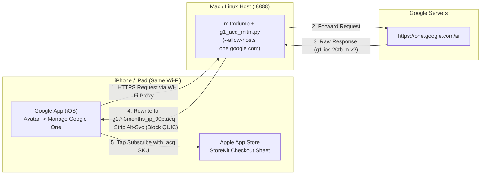
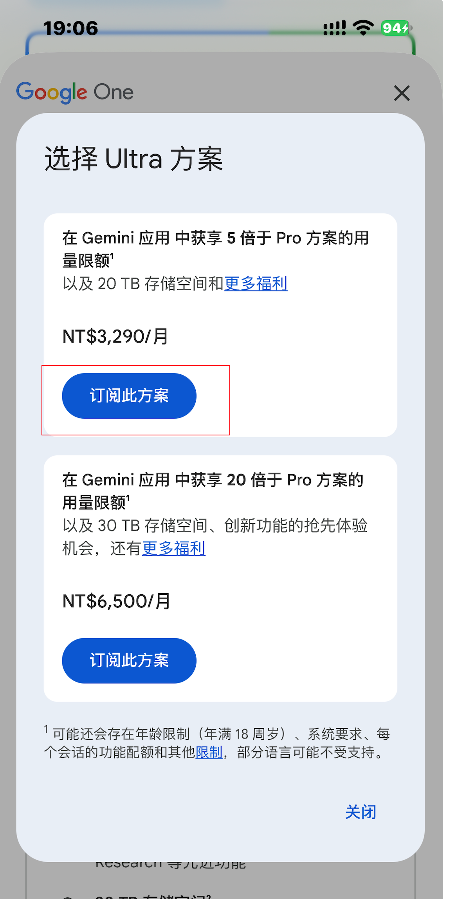
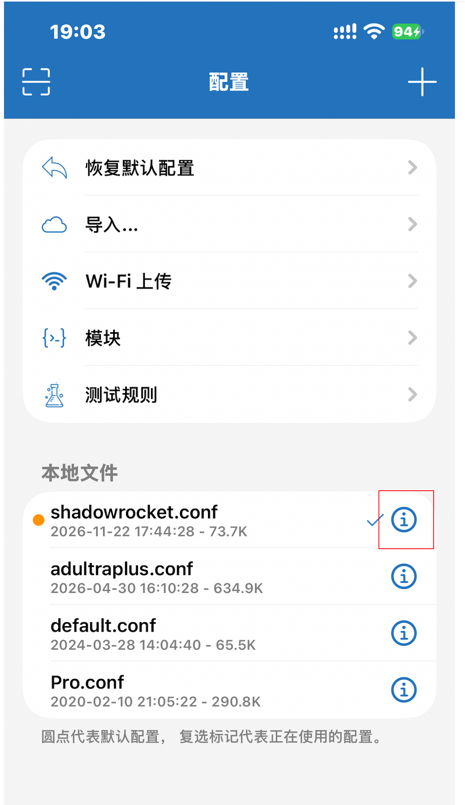

# g1-acq-mac-proxy

**Free macOS & Linux MITM Proxy for Google One (iOS) Promotional SKU Mapping (20TB / 30TB Google AI Ultra — 90% / 75% Off)**

> **AI Agent Ready**: Give this repository URL to any AI coding agent (Claude Code, Cursor, Antigravity, Windsurf, Codex) and say *"Run this proxy for my iPhone"*. The agent can follow [`AGENTS.md`](./AGENTS.md) to set up and diagnose everything automatically.

---

## Overview

On iOS, the **Google App** loads its Google One subscription management page from `https://one.google.com/ai?...` inside an in-app WebView and triggers **Apple App Store (StoreKit)** In-App Purchases using the SKU strings embedded in that response.

Normally, the iOS page binds the **20 TB** and **30 TB Google AI Ultra** buttons to standard full-price monthly SKUs (`g1.ios.20tb.m.v2` and `g1.ios.30tb.ai.pro.m`). By rewriting those two SKU identifiers in the `one.google.com/ai` HTTP response to Google's introductory promotional `.acq` SKUs (`90% off` or `75% off` for 3 months), tapping **Subscribe** opens the Apple App Store checkout sheet with the promotional introductory plan.

Previously, doing this on iOS required buying **Shadowrocket** (\$2.99 on the App Store). **`g1-acq-mac-proxy` provides a 100% free alternative** using `mitmproxy` on your Mac or Linux PC over the same Wi-Fi network — plus includes the standalone Shadowrocket module in [`shadowrocket/`](./shadowrocket/) if you want both options.



---

## SKU Mapping Table

| Plan Tier | Original iOS Monthly SKU | Primary Promo SKU (90% Off / 3 Mo) | Fallback Promo SKU (75% Off / 3 Mo) |
| :--- | :--- | :--- | :--- |
| **Google AI Ultra 20 TB** | `g1.ios.20tb.m.v2` | `g1.20tb.3months_ip_90p.acq` | `g1.20tb.3months_ip_75p.acq` |
| **Google AI Ultra 30 TB** | `g1.ios.30tb.ai.pro.m` | `g1.ai.ultra.3months_ip_90p.acq` | `g1.ai.ultra.3months_ip_75p.acq` |

- **Catalog-Aware Fallback**: The proxy first scans the `one.google.com/ai` response body for all `g1.*.acq` SKUs actually present in the account's catalog. If the primary `90p.acq` SKU is absent while the `75p.acq` SKU is present, it automatically falls back to `75p.acq`.
- **Eligibility Requirement**: Introductory `.acq` SKUs are acquisition promotions. The Google account must **not** currently have an active Google One subscription, and the `.acq` SKU must exist in the account's catalog.

---

## Quick Start (Method 1: Free Mac / Linux Proxy for iPhone)

### 1. Start the Proxy on Your Mac or Linux PC

Clone this repository and run `./start-proxy.sh`:

```bash
git clone https://github.com/hello-tako/g1-acq-mac-proxy.git
cd g1-acq-mac-proxy
chmod +x start-proxy.sh
./start-proxy.sh
```

What `./start-proxy.sh` does automatically:
1. Detects your computer's local Wi-Fi LAN IP address (e.g. `192.168.x.x`).
2. Creates an isolated Python virtual environment (`.venv`) and installs `mitmproxy`.
3. Starts `mitmdump` on port `8888` with a strict `--allow-hosts` rule so **only `one.google.com` is decrypted**, leaving Apple App Store, iCloud, and all other apps untouched.
4. Prints the exact **Server IP** and **Port (`8888`)** to enter on your iPhone.

---

### 2. Configure Your iPhone / iPad (One-Time Setup, ~1 Minute)

#### Step A — Set Wi-Fi HTTP Proxy
1. Connect your iPhone/iPad to the **same Wi-Fi network** as your Mac/PC.
2. Open iOS **Settings → Wi-Fi** and tap the blue **`(i)`** icon next to your connected Wi-Fi network.
3. Scroll all the way to the **very bottom** of the screen to the **HTTP PROXY** section *(do **not** modify "Configure IP" in the middle of the page — leave "Configure IP" set to Automatic)*.
4. Tap **Configure Proxy → Manual** and enter:
   - **Server**: `<YOUR_MAC_LAN_IP>` *(printed by `./start-proxy.sh`, e.g. `192.168.2.104`)*
   - **Port**: `8888`
   - *(Leave Authentication Off)* → Tap **Save** in the top-right corner.

#### Step B — 1-Click CA Certificate Install & Root Trust
> **Why `http://<YOUR_MAC_LAN_IP>:8888` instead of `mitm.it`?**
> Modern iOS Safari automatically upgrades `mitm.it` to `https://mitm.it:443`, which can fail or show *"traffic is not going through mitmproxy"* before the certificate is trusted. `g1_acq_mitm.py` serves the iOS `.pem` configuration profile directly over plain HTTP when you visit your Mac's LAN IP.

1. Open **Safari** on your iPhone and go to:
   ```text
   http://<YOUR_MAC_LAN_IP>:8888
   ```
   *(Replace `<YOUR_MAC_LAN_IP>` with the IP printed in your terminal).*
2. Tap **Allow** when iOS asks: *"This website is trying to download a configuration profile."*
3. Open iOS **Settings** → tap **Profile Downloaded** near the top (or go to **Settings → General → VPN & Device Management**) → select **mitmproxy** → tap **Install** and enter your iPhone passcode.
4. **CRITICAL STEP (Do Not Skip)**:
   Go to iOS **Settings → General → About** → scroll to the **very bottom** → tap **Certificate Trust Settings**.
   Under *"Enable full trust for root certificates"*, toggle **ON (Green)** the switch next to **`mitmproxy`** and tap **Continue**.
   *(If this switch is not turned on, iOS will reject the TLS handshake for `one.google.com`!).*

---

### 3. Trigger the Google AI Ultra Discount on iPhone

1. Install and open the **Google App** from the iOS App Store (the multi-colored **G** icon — **do not** use the standalone Google One native app, as it uses a different native gRPC endpoint).
2. Sign in with your target Google account.
3. Tap your **Profile Avatar** (top-right) → tap **Manage Google One**.
4. Open the **Ultra** plan selection panel and tap **Subscribe** on either the **20 TB** or **30 TB** plan:



5. The **Apple App Store** payment sheet will pop up with the promotional introductory discount (`90% off` or `75% off` for the first 3 months).
6. **Clean Up**: After completing your purchase, go back to iOS **Settings → Wi-Fi → (i) → Configure Proxy** and switch it back to **Off**.

---

## Environment Variables & Advanced Options

You can customize `./start-proxy.sh` using environment variables:

| Variable | Default | Description |
| :--- | :--- | :--- |
| `G1_PROXY_PORT` | `8888` | TCP port for the HTTP/HTTPS proxy server. |
| `G1_HOST_IP` | *(Auto-detected)* | Override the detected LAN IP address of the host machine. |
| `G1_STRICT_CATALOG` | `0` | Set `G1_STRICT_CATALOG=1 ./start-proxy.sh` to **only** rewrite SKUs when at least one `.acq` promotional SKU is present in the account's server-side catalog. Prevents the Ultra card from being hidden on accounts that are not eligible for `.acq` promotions. |

---

## Troubleshooting Guide

| Symptom on iPhone / Terminal Log | Root Cause | Solution |
| :--- | :--- | :--- |
| iOS Wi-Fi settings shows *"IP Address, Subnet Mask, Router"* | You tapped **Configure IP** (middle of the Wi-Fi page) instead of **Configure Proxy** (bottom of the Wi-Fi page). | Leave **Configure IP** set to **Automatic**. Scroll all the way to the bottom of the Wi-Fi details page and tap **Configure Proxy → Manual**. |
| Safari shows *"If you can see this, traffic is not going through mitmproxy"* on `mitm.it` | iOS Safari auto-upgraded `mitm.it` to `https://mitm.it:443`. | Visit `http://<YOUR_MAC_LAN_IP>:8888` in Safari instead — it serves the `.pem` profile directly over plain HTTP in one click. |
| Terminal log shows `Client TLS handshake failed... client does not trust the proxy's certificate` for `one.google.com` | The `mitmproxy` profile was installed in *VPN & Device Management*, but Root Certificate Trust was not enabled. | Go to iOS **Settings → General → About → Certificate Trust Settings** (at the very bottom) and toggle **ON (Green)** the `mitmproxy` switch. Then force-close and reopen the Google App. |
| Terminal log shows `Promotional (.acq) SKUs in account catalog: NONE` and the Ultra plan card disappears in the Google App | This Google account does not have `.acq` promotional SKUs in its catalog. When `g1.ios.20tb.m.v2` is replaced by a SKU that is not in the response's price catalog, the web UI hides the card. | Switch to an eligible Google account (must have no active Google One subscription), or run `G1_STRICT_CATALOG=1 ./start-proxy.sh` so ineligible accounts keep their standard plans visible. |
| iPhone has no internet connection while Proxy is set to Manual | `./start-proxy.sh` is no longer running on the Mac/PC, or the Mac's LAN IP changed. | Make sure `./start-proxy.sh` is running in your terminal. When you are not actively using the proxy, set iOS **Wi-Fi → Configure Proxy → Off**. |

---

## Alternative: Standalone Shadowrocket Module (iOS)

If you already own **Shadowrocket** on iOS and prefer an on-device VPN module without a Mac/PC:

1. In Shadowrocket, go to **Config → tap `(i)` next to your active config → HTTPS Decryption**:
   - Turn on **HTTPS Decryption**.
   - Generate and install the new CA certificate, then enable full trust in iOS **Settings → General → About → Certificate Trust Settings**.



2. Go to **Config → Modules → tap `+`** (top-right) and install:
   ```text
   https://cdn.jsdelivr.net/gh/hello-tako/g1-acq-mac-proxy@main/shadowrocket/g1-acq.sgmodule
   ```

---

## Security & Privacy Boundary

- **Zero External Telemetry**: Neither [`g1_acq_mitm.py`](./g1_acq_mitm.py) nor [`shadowrocket/g1-acq.js`](./shadowrocket/g1-acq.js) makes any external network requests. All logs stay strictly on your local machine.
- **Minimal MITM Scope**: `./start-proxy.sh` passes `--allow-hosts '^one\.google\.com...'` to `mitmdump`. Traffic to Apple (`*.apple.com`), Google Authentication (`accounts.google.com`), and all other websites is tunneled directly without TLS interception.
- **Local CA Generation**: Your `mitmproxy` Root CA certificate is generated locally in `~/.mitmproxy/` on your own machine and is never shared.

---

## Credits & License

- Inspired by the original Shadowrocket module concept by [`crhywun/g1-acq`](https://github.com/crhywun/g1-acq).
- Released under the [MIT License](./LICENSE).
